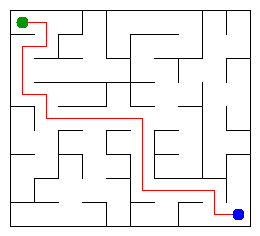

# Assignment 3. Maze Escape

Student ID: **252223**  
Name: **Assylzhan Abishev**  
Group: **SE-2512**  
Maze size: **9 rows x 10 columns (90 cells)**

## Run

Use JDK 17 or newer. Open a terminal in this folder.

```sh
java tools/Check.java
java -cp out Main
```

The checker compiles the sources. Alternatively: `javac -d out src/*.java`.
Open `output/maze.html` after running Main. The checker runs other examples and
overwrites the picture, so always run Main again afterwards to restore your own maze.

## Program output

```text
Broken: 89
Kept: 72
Last broken wall: 131
MST cost: 26896
Heaviest broken wall: 672
Path length: 19
DFS visited: 64
Dead ends: 30
Zones: 90
Largest zone: 1
Is DAG: 1
Flow stages: 15
Fastest route cost: 29
```



The picture shows Mission 1, not the minimum-cost maze from Mission 2.
The HTML page uses the unchanged teacher-provided renderer. With zones enabled,
all 90 cells have separate colours because this variant has no directed cycle.
Turn zones and slides off to see only the maze; enable way out to show the path.
No external maze website is used to generate this variant.

## Questions

### Mission 0
`find(x)` returns the representative of the set containing x. `union(a,b)`
joins two different sets and returns false if they were already together.
Union by size keeps trees shallow, and path compression flattens each visited path.

### Mission 1
The full rectangular grid is connected. Each successful union joins two components,
so reaching one component from n cells requires exactly n-1 broken walls.
There are R(C-1)+C(R-1) inner walls; subtracting RC-1 gives (R-1)(C-1) kept walls.

### Mission 2
Kruskal and Prim both give **26896**. Kruskal takes the cheapest edge joining
different components; Prim takes the cheapest edge leaving the current tree.
Both follow the MST cut property; all weights here are distinct, so the MST is unique.

### Mission 3
The maze is connected and has no cycle, so it is a tree and has exactly one simple
path between any two cells. DFS uses explicit array frames with a next-direction
index, preserving up/right/down/left order without recursive Java calls.
The visited counter stops as soon as the exit is marked, while dead ends count the whole maze.

### Mission 4
The first pass stores finish order in the original graph. Processing decreasing
finish times in the reversed graph isolates each SCC instead of walking forward
into other components, and produces topologically ordered component IDs.
Because self-loops are forbidden in these inputs, a directed cycle exists exactly
when some SCC has more than one vertex, so the graph is acyclic exactly when Zones = n.

### Mission 5
Every cross-zone edge goes from a smaller ID to a larger ID, so all incoming
updates are complete before processing a zone. Parallel edges are merged using
their minimum cost and internal edges are discarded because travel inside a zone is free.
Building the graph takes expected O(n+m); the ordered DP pass takes O(K+E),
where K is the number of zones and E the number of distinct cross-zone edges.

## AI use

ChatGPT generated this implementation, additional tests, report draft and study guide
from the supplied starter, and ran the checks and benchmarks. The teacher-provided
generator, main program, input helpers, graph helpers, renderer and benchmark are unchanged.
The local Git commits record this AI-assisted build and use an assistant author;
they do not represent independent student work.
Before submission, I need to review, understand and adapt the generated work and
rewrite explanations in my own words as required by the assignment.
No outside graph or DSU library was used.

## Timing (Mission 7)

Actual measurements in milliseconds, five runs of the unchanged Bench class.
Environment: Linux, OpenJDK 17.0.20, shared execution environment.
These are measurements here, not on the student's laptop; rerun locally if required.

| Maze | Kruskal runs | Kruskal mean | Prim runs | Prim mean |
|---|---|---:|---|---:|
| 100 x 100 | 20, 9, 9, 12, 22 | 15 | 20, 9, 8, 9, 8 | 11 |
| 300 x 300 | 210, 163, 82, 87, 107 | 130 | 98, 94, 108, 95, 89 | 97 |
| 1000 x 1000 | 1679, 1709, 1995, 2092, 8956 | 3286 | 3120, 3006, 3370, 5093, 9956 | 4909 |

Grid walls grow roughly proportionally to cells; both MST implementations have
O(m log m) bounds on this grid. The larger cases take more time, but JIT warm-up,
garbage collection and shared-machine load cause noise, especially in the final runs.
Five measurements do not establish an exact empirical growth law.

Raw output: [benchmark.txt](benchmark.txt).

## Complexity

n = cells; m = walls or slides; K = zones; E = distinct cross-zone edges.
Space includes auxiliary arrays and adjacency representations.

| Algorithm | Time | Space | Assumptions |
|---|---|---|---|
| DSU find / union | O(alpha(n)) amortized | O(n) overall, O(1) per call | Size + path compression |
| Input-order maze | O(n + m alpha(n)) | O(n) | Connected rectangular grid |
| Kruskal | O(n + m log m + m alpha(n)) | O(n+m) | Comparison sorting of edge indices |
| Prim | O(n + m log m) | O(n+m) | Lazy edge priority queue; O(log n) equivalent on grid |
| DFS | O(n+m) | O(n+m) | Iterative; at most 4 grid neighbours |
| Kosaraju | O(n+m) | O(n+m) | Two iterative passes |
| Zone graph construction | O(n+m) expected | O(K+E) extra | HashMap minimum per zone pair |
| Route / stages DP | O(K+E) | O(K) beyond graph | Topological zone IDs |

## Verification

- Supplied tiny, small and dag examples: all 13 lines match.
- DSU tests include self unions, duplicate unions and 100,000 elements.
- AlgorithmTest checks 200 seeded random cases: SCCs against transitive closure,
  route/stage DP against repeated relaxation, Kruskal against Prim, DFS paths against BFS.
- A 1000 x 1000 serpentine maze and a million-vertex directed chain exercise
  iterative DFS and Kosaraju with a small Java stack.

```sh
java -Xmx1g -Xss256k -cp out AlgorithmTest
```

## Submission status

Included: source, personal input, PNG, HTML, report, measured timing and local Git history.
Not completed: student review/adaptation, creation of a public GitHub repository,
push to main, and submission of its link in Moodle.
See INSTRUCTIONS_RU.md for the remaining steps.
